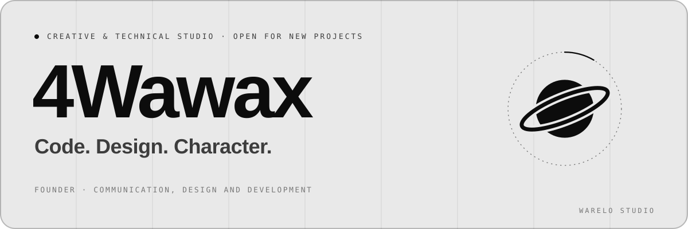
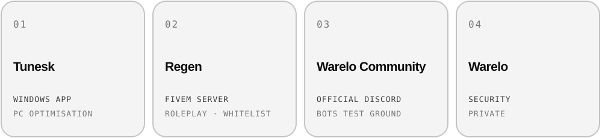
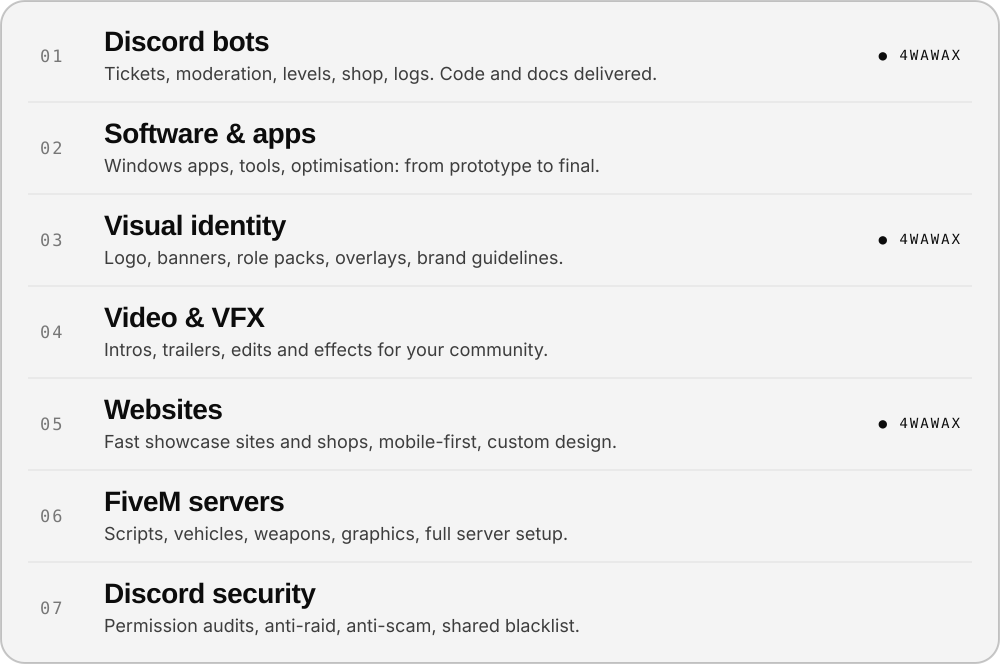
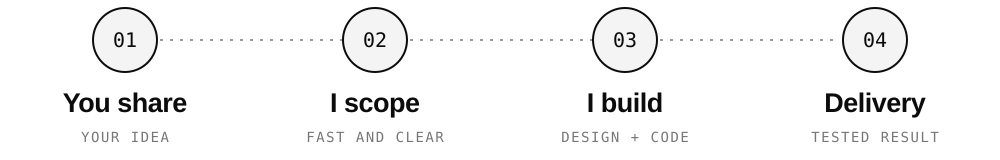
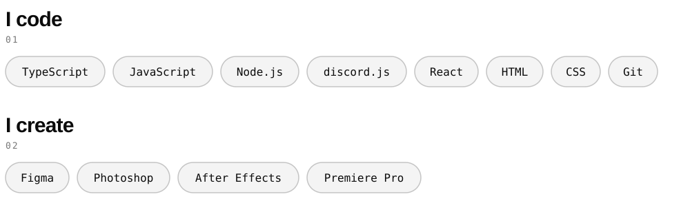

[🇫🇷 Français](README.md) · [🇬🇧 English](README.en.md)

<picture><source media="(prefers-color-scheme: dark)" srcset="assets/banner-en-dark.svg"></picture>

I'm **4Wawax**, founder of **Warelo Studio**. I lead the creation and organisation of the studio: **brand identities, Discord bots and websites**.

> I'm the link between your idea and its delivery — **one single point of contact and fast replies**, from the first message to the final result.

`Communication` `Design` `Management & organisation` `Discord bots` `Websites`

## 01 — Brands

Our brands, our testing ground.

<picture><source media="(prefers-color-scheme: dark)" srcset="assets/brands-en-dark.svg"></picture>

## 02 — Expertise

One studio for your whole project. ● = what I lead personally.

<picture><source media="(prefers-color-scheme: dark)" srcset="assets/expertise-en-dark.svg"></picture>

## 03 — How we work

<picture><source media="(prefers-color-scheme: dark)" srcset="assets/process-en-dark.svg"></picture>

## My stack

<picture><source media="(prefers-color-scheme: dark)" srcset="assets/stack-en-dark.svg"></picture>

## My universe

- **Warelo Studio** — the studio I'm building with 4Warris.
- **4W Suprématie** — my Discord community and my Minecraft server.
- *Create, deliver, repeat.*

## 04 — Team

| | |
|---|---|
| **4Wawax** | Founder · communication, design and development |
| **4Warris** | Founder · developer and software engineer |
| **Vestii** | Staff · advice and creative direction |

## 05 — Contact

Have an idea? Describe your project in a few lines — you'll get a quick answer, no jargon.

<code>POWERED BY WARELO STUDIO</code>

