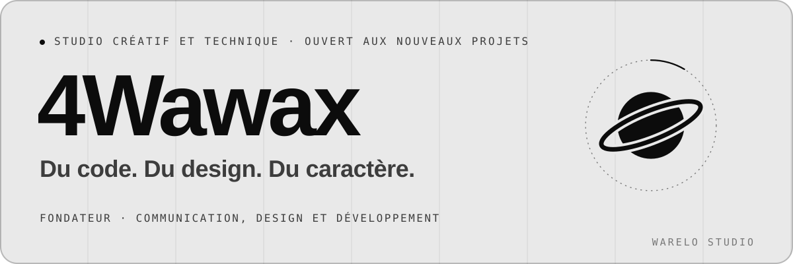
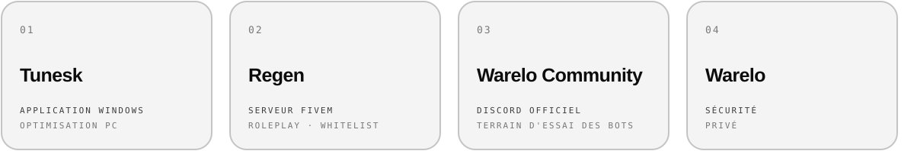
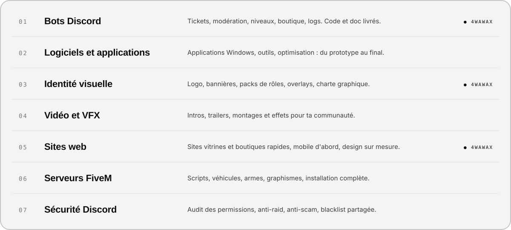
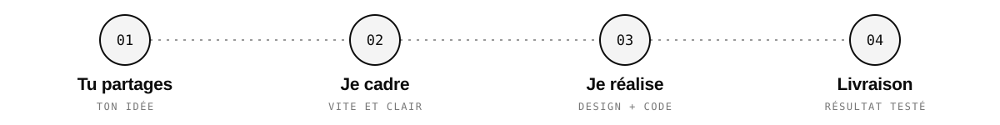

[🇬🇧 English](README.md) · [🇫🇷 Français](README.fr.md)

<picture><source media="(prefers-color-scheme: dark)" srcset="assets/banner-fr-dark.svg"></picture>

Je suis **4Wawax**, fondateur de **Warelo Studio**. Je pilote la création et l'organisation du studio : **identités, bots Discord et sites web**.

> Je fais le lien entre ton idée et sa réalisation — **un seul interlocuteur et des réponses rapides**, du premier message au résultat final.

`Communication` `Design` `Gestion et organisation` `Bots Discord` `Sites web`

## 01 — Marques

Nos marques, nos terrains d'essai.

<picture><source media="(prefers-color-scheme: dark)" srcset="assets/brands-fr-dark.svg"></picture>

## 02 — Expertise

Un seul studio pour tout ton projet. ● = ce que je pilote personnellement.

<picture><source media="(prefers-color-scheme: dark)" srcset="assets/expertise-fr-dark.svg"></picture>

## 03 — Comment on travaille

<picture><source media="(prefers-color-scheme: dark)" srcset="assets/process-fr-dark.svg"></picture>

## Technos & outils

<picture><source media="(prefers-color-scheme: dark)" srcset="https://skillicons.dev/icons?i=ts,js,nodejs,react,html,css,git,github,figma,ps,ae,pr&perline=12&theme=dark"></picture>

`TypeScript` `JavaScript` `Node.js` `discord.js` `React` · `Figma` `Photoshop` `After Effects` `Premiere Pro`

## 04 — Équipe

| | |
|---|---|
| **4Wawax** | Fondateur · communication, design et développement |
| **4Warris** | Fondateur · développeur et ingénieur logiciel |
| **Vestii** | Staff · conseil et direction créative |

## 05 — Contact

Une idée ? Décris ton projet en quelques lignes — tu auras une réponse rapide, sans jargon.

<code>POWERED BY WARELO STUDIO</code>

