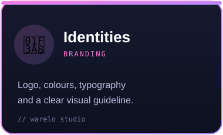
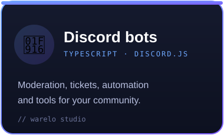
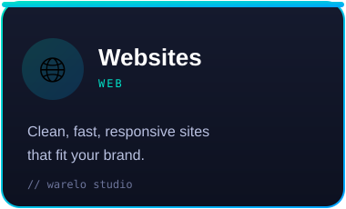
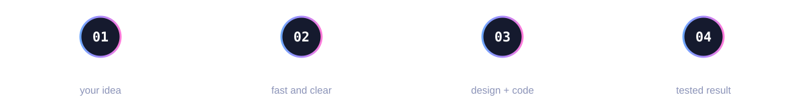

[🇬🇧 English](README.md) · [🇫🇷 Français](README.fr.md)

## 👋 À propos

Je suis **4Wawax**, fondateur de **Warelo Studio**. Je m'occupe de la **communication, du design et du développement**, et je pilote la création et l'organisation du studio : **identités, bots Discord et sites web**.

> Je fais le lien entre ton idée et sa réalisation — **un seul interlocuteur, des réponses rapides**, du premier message au résultat final.

## 🛠️ Ce que je crée

<table>
<tr>
<td width="33%"></td>
<td width="33%"></td>
<td width="33%"></td>
</tr>
</table>

## 🔄 Comment on travaille

## 🧰 Technos & outils

`TypeScript` `JavaScript` `Node.js` `discord.js` `React` · `Figma` `Photoshop` `After Effects` `Premiere Pro`

## 🚀 Projets

| Projet | C'est quoi |
|---|---|
| [**4WAWAX**](https://4wawax.fr) | Mon activité : vidéo, photo, design, web |
| **Warelo Studio** | Le studio : identités, bots Discord et sites web |
| **4W Suprématie** | Ma communauté Discord et mon serveur Minecraft |

## ❓ FAQ

<b>À qui vais-je parler ?</b>

 Toujours à moi. Pas d'intermédiaire, donc rien ne se perd entre design, code et communication.

<b>Tu réponds vite ?</b>

 Oui. Un message sur Discord ou par email est le moyen le plus simple de démarrer.

<b>Peux-tu faire identité, bot et site ensemble ?</b>

 Oui — c'est tout l'intérêt du studio : un résultat cohérent sur les trois.

## 📫 Parlons-en

Une idée ? **[Rejoins le Discord](https://discord.gg/PgChvpfgBB)** ou écris à **[contact@warelo.fr](mailto:contact@warelo.fr)** — tu auras une réponse rapide.

Créer, livrer, recommencer.

